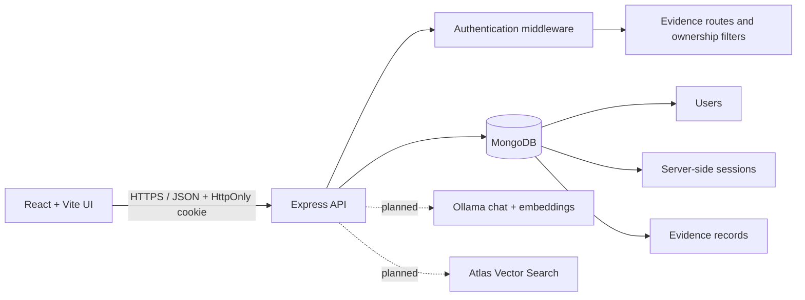

# Architecture (initial milestone)

The browser is not trusted for identity, role, owner IDs, or access grants. The API derives the current user from the server-side session. The initial evidence routes always scope queries to `req.user._id`. AI retrieval, grants, and public projections are planned and must preserve these access boundaries.
